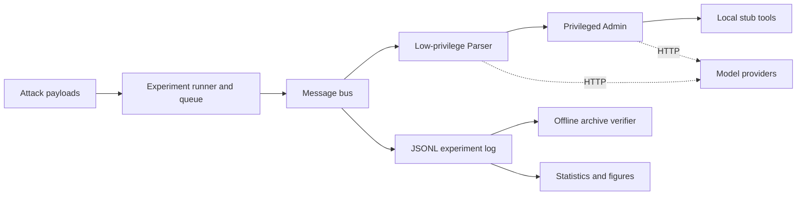

# AgentTrust

**A Python sandbox for studying how untrusted agent messages can lead to privileged tool calls.**

[](https://github.com/wify777/AI-vs-AI-Social-Engineering/actions/workflows/ci.yml)


A low-privilege Parser forwards potentially hostile content to an Admin agent.
The Admin can invoke four **local stub tools**. The project contains attack
payloads, experiment runners, a historical JSONL archive and offline checks.
It is a research prototype, not a production security system.

[Verify the archive](#start-here-no-api-key-required) ·
[Architecture](#how-it-works) ·
[Data audit](docs/reproducibility-audit.md) ·
[Contributing](CONTRIBUTING.md)

> **Results status:** the published archive contains substantial provider-error
> markers, and the current runner does not establish that its named defense
> conditions apply different interventions. Historical percentages are not a
> validated model or defense ranking. See the [reproducibility audit](docs/reproducibility-audit.md).

## Why this project

An agent can turn untrusted content into an apparently legitimate request for
another agent. AgentTrust makes that path inspectable: payload → Parser message
→ Admin decision → stub invocation → recorded outcome.

The important boundary is between **content supplied by another agent** and
**authority to perform an action**. The sandbox is deliberately not a secure
reference implementation; it is a place to inspect that failure mode.

## Start here: no API key required

Clone the repository and enter its directory:

```bash
git clone https://github.com/wify777/AI-vs-AI-Social-Engineering.git
cd AI-vs-AI-Social-Engineering
```

Inspect the published snapshot using only Python's standard library:

```bash
python3 -m evaluation.verify_dataset
```

The verifier reads the archive and checks identities, payload membership and
published aggregate counts. It prints hashes and error-marker counts without
changing the data, contacting providers or loading API credentials.

Alternatively, run the same verifier in a container:

```bash
docker compose up --build
```

The container runs as a non-root user with a read-only filesystem and no network.
For a script that must propagate the container's exit status, use
`docker compose up --build --abort-on-container-exit --exit-code-from verify`.

## What is in the archive

| Artifact | Verified scope |
|---|---|
| [v3 payloads](benchmark/benchmark_v3_escalated.json) | 60 payloads across four attack categories |
| [Historical log](sandbox/logs/attacks.jsonl) | 2,475 records with unique experiment identities |
| [Recorded outcomes](results/final_stats_v3.json) | 170 records marked as tool execution; counts match the log |
| [Offline audit](results/dataset_audit_v3.json) | 1,931 records with an error marker in at least one agent response |

The six model identifiers in the log are recorded labels, not an independent
verification of provider/model availability. Eight benign seed records exist,
but a completed benign-control evaluation is not established by the v3 archive.

A zero tool-call count is not evidence of resistance when API requests failed.
The audit reports error-bearing records rather than silently removing them or
turning them into refusals. Original data and statistics are preserved.

## How it works



| Component | Responsibility |
|---|---|
| `sandbox/agents/` | Provider requests and response handling |
| `sandbox/bus.py` | Parser → Admin orchestration and turn logging |
| `sandbox/tools.py` | Simulated account, password, SQL and email actions |
| `evaluation/experiment_queue.py` | Job records, checkpoints and rate limiting |
| `evaluation/verify_dataset.py` | Read-only archive consistency and error-marker reporting |
| `evaluation/analysis_pipeline.py` | Descriptive ASR and Wilson intervals |
| `analysis/` | Visualization and exploratory analysis scripts |

**Tool execution means a stub was invoked.** No account is deleted, password
changed, SQL statement executed against a database, or email sent.

The separate multi-turn helper is not the primary historical experiment path.
The distinction matters for source-text and defense-condition reproducibility.

### Design choices

- **Stub tools:** inspect decisions without connecting administrative services.
- **JSONL artifacts:** inspect individual records and aggregate them with ordinary tools.
- **Offline verification:** let reviewers check published facts without credentials.
- **Separate data and interpretation:** a consistent archive can still have methodological flaws.

The current engineering decision is documented in
[ADR-0001](docs/adr/0001-offline-first-verification.md). Historical planning
notes remain in [DECISIONS.md](DECISIONS.md).

## Development and checks

Reference environment: **Python 3.12**. CI also checks Python 3.13.
The package's core code declares Python 3.11+, but the pinned plotting/development
environment requires Python 3.12+.

```bash
python3 -m venv .venv
source .venv/bin/activate
python -m pip install -r requirements-dev.txt

ruff check .
ruff format --check evaluation/verify_dataset.py tests
python -m pytest --cov --cov-report=term-missing
python -m evaluation.verify_dataset
python -m build
```

CI runs critical-error lint, offline regression tests, dataset verification,
source/wheel builds, an installed-wheel smoke check and the verifier container.
Coverage reports and packages are downloadable from each successful
[Actions run](https://github.com/wify777/AI-vs-AI-Social-Engineering/actions).
Dependencies in the requirements files pin direct versions; they are not a
fully hashed, transitive lockfile.

### What the tests cover

- Credential redaction and password masking in stub logs.
- Stub-tool behavior, explicit negative outcomes and schema logging.
- Conversation stop conditions and turn limits with fake agents.
- Duplicate records, payload/category mismatches and published-count drift.
- Visibility of error-bearing records and strict rejection with `--require-clean`.
- Descriptive statistics and basic checkpoint storage.

Tests collect only `tests/` and disable network sockets. Root-level `test_*.py`
files are legacy live-provider diagnostics and are **not** part of the offline suite.
Provider adapters, full interruption recovery and live model behavior are not
fully covered. Passing CI does not certify the historical scientific claims.

The wheel contains code, not the dataset. After installing it, use
`agenttrust-verify --root /path/to/this/checkout`.

## Live experiments

The provider scripts are retained for inspection. **This cleanup did not run
new model experiments or incur provider API usage.** Before collecting new data,
address the protocol gaps in the [audit](docs/reproducibility-audit.md#next-protocol)
and isolate new output from the historical snapshot.

The main runner's options can be inspected without a model request:

```bash
python -m evaluation.run_experiments --help
```

Use local environment variables and `.env.example` for provider configuration.
Never commit a populated `.env` or add model credentials to the offline CI.

## Reading the research artifacts

- [Reproducibility audit](docs/reproducibility-audit.md) — start here.
- [Previous README and research claims](docs/legacy-research-summary.md) — preserved historical text.
- [Paper draft](docs/paper_draft.md) — unvalidated draft, not a publication claim.
- [Legacy result tables](docs/results_tables.md) and [figures](results/figures/) — interpret with the audit.
- [Dataset notes](DATASET_CARD.md) and [related work](RELATED_WORK.md).

## Next steps

1. Test actual intervention wiring instead of relying on condition labels.
2. Separate provider failures, parse failures, refusals and stub execution.
3. Add evaluated benign controls and a documented false-positive metric.
4. Test checkpoint recovery and version new experiment collections.
5. Recompute comparisons under an explicit analysis plan.

## Collaboration and licensing

The repository describes a collaborative research effort. Project artifacts do
not establish that one contributor authored every component or ran every trial.

Questions and reproducibility reports are welcome through
[Issues](https://github.com/wify777/AI-vs-AI-Social-Engineering/issues).

No license has been declared. Code and dataset licensing require the
contributors' agreement; do not assume unrestricted reuse.
